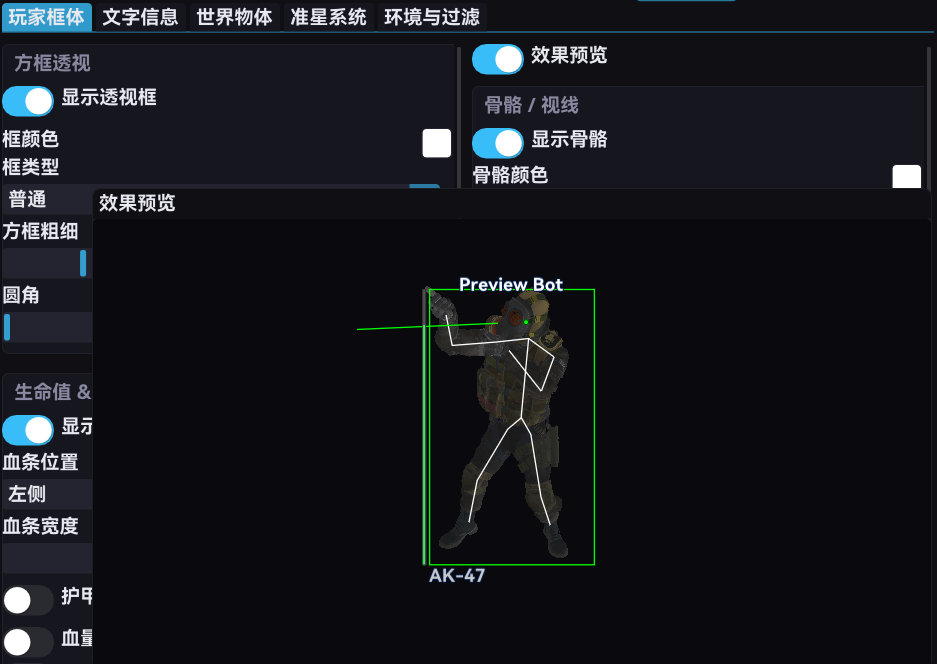
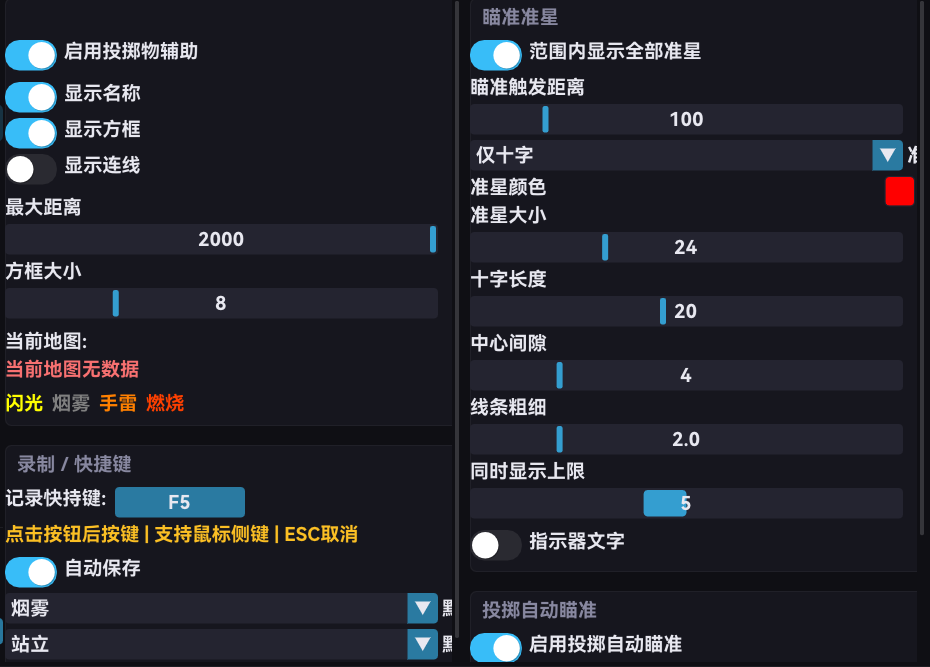
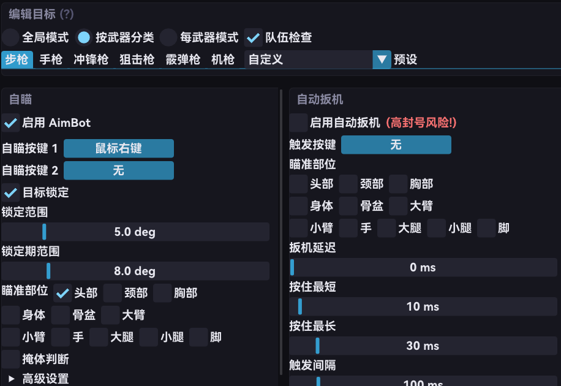
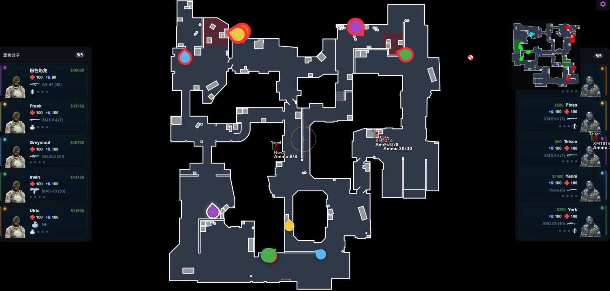
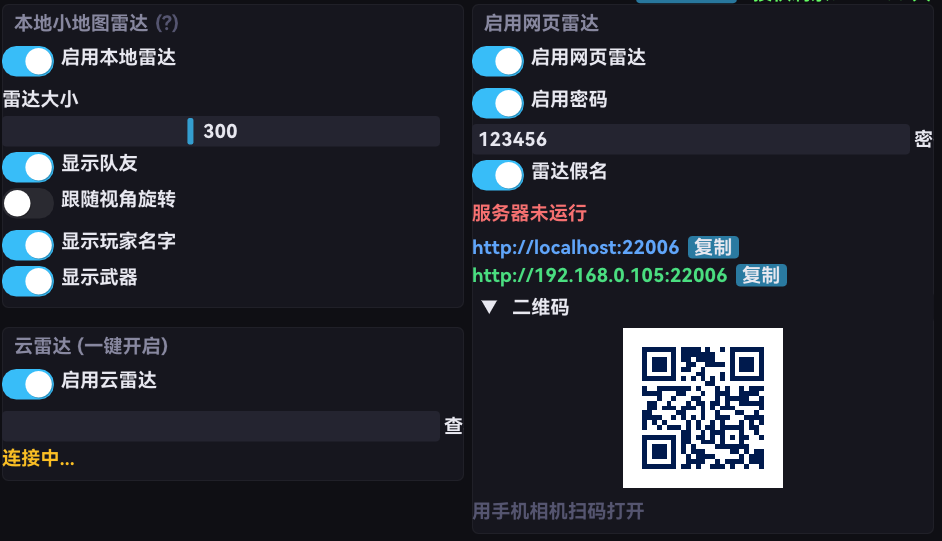
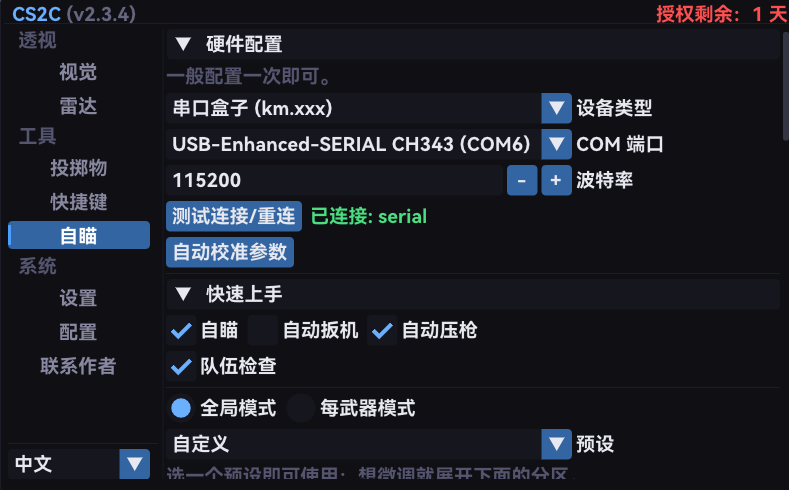

**English** | **[中文](README_CN.md)**

# CS2C · Hardware-Level CS2 Full-Featured Assist System

> **FPGA · LOCAL PROCESSING · NO INTRUSION · NO MODIFICATION**

A hardware-level external assist system for Counter-Strike 2, written in C++. A DMA device (FPGA development board) is installed in the **main machine (the gaming PC)**, where it performs fast reading and reprocessing of the simulated memory data already present on the board. **All computation runs locally on the secondary machine (the control PC)**, and mouse movement is delivered to the main machine through a **KMBox / MAKCU hardware box** — no drivers, no software on the main machine.

> This software cannot be used on real computer systems. It only performs fast reading and reprocessing of the simulated memory data already present on the FPGA development board, with no intrusion, control, or modification of any computer system or other security functions. For learning and research purposes only; users are solely responsible for any consequences of improper use.


> ⭐ If you like this project, please give it a **Star** to support ongoing updates!
> 💬 Join the **QQ group: 965428002** for help and news.

| Entry | Link |
| --- | --- |
| 🚀 **Full Version CS2C** (Get Access) | [Buy (China)](https://shop.95fk.net/shop/OJ3QCIOK) · [Buy (Global)](https://cn.chaovt.xyz/shop) |
| 🌐 **Official Website** | <https://cn.chaovt.xyz> |
| 🧾 **User Center** (self-service rebind / remaining time / download) | <https://cn.chaovt.xyz/user> |
| 📦 **Open-source Free Version** | [GitHub Releases](https://github.com/chao-shushu/CS2-DMA/releases) |

---

## Two Editions

| | **Open-source · CS2DMA** | **Full Version · CS2C** |
| --- | --- | --- |
| Executable | `CS2DMA.exe` | `CS2C.exe` |
| How to get | Free download from [GitHub Releases](https://github.com/chao-shushu/CS2-DMA/releases) | License activation ([purchase](https://shop.95fk.net/shop/OJ3QCIOK) / [website](https://cn.chaovt.xyz)) |
| Full-element ESP | ✅ | ✅ |
| Grenade Helper (lineups + aim reticle + in-game recording) | ✅ | ✅ |
| Multi-config / bilingual UI / offset cloud sync | ✅ | ✅ |
| Aimbot | ❌ | ✅ |
| TriggerBot | ❌ | ✅ |
| Standalone RecoilControl | ❌ | ✅ |
| Radar suite (local 2D / web panel / cloud radar) | ❌ | ✅ |
| Grenade auto-aim + one-click presets | ❌ | ✅ |
| Hardware box config page | ❌ | ✅ |
| User center / license activation | ❌ | ✅ |
| Memory decryption · auto repair | ❌ | ✅ |

> Both editions share identical **ESP** and **Grenade Helper** capabilities, all based on simulated memory data on the FPGA development board, with no intrusion, control, or modification of any kind.



---

## Architecture & Hardware Chain

```
[Main machine · Gaming PC]  Runs CS2 + DMA card (FPGA dev board plugged in)
      ▲                        │
      │ mouse via hardware box │ USB data read
      │                        ▼
[Secondary machine · Control PC]  FPGA board over USB → all computation locally → render black-background ESP
      │
      │ fusion box removes black background, overlays ESP
      ▼
[Main machine screen]  Game image + ESP outlines
```

- **Main machine = gaming PC**: runs the game and holds the DMA card, with **no software or drivers installed**.
- **Secondary machine = control PC**: connects to the DMA card over USB and runs `CS2C.exe` / `CS2DMA.exe`; all computation happens locally.
- **Mouse delivery**: the aim/recoil corrections are sent to the main machine through a **KMBox / MAKCU hardware box** as real mouse movement — **the game memory is never written**.
- **Overlay**: the control PC renders a black-background ESP, a fusion box removes the black background, and the result is overlaid on the main machine's screen.

---

## Features

### ESP (both editions)

**Players**
- **Box ESP** — Normal / Dynamic / Corner styles with adjustable thickness, rounding, and corner length
- **Bone ESP** — Full skeleton with adjustable thickness and smooth (spline) bones
- **3D Model Fill** — Semi-transparent head sphere + torso/limb capsules, colored by visibility
- **Health Bar / Armor Bar** — Adjustable position, color, width, with numeric labels
- **Weapon ESP** — Weapon name + icon (built-in icon font) + ammo count (low-ammo warning)
- **Player Name / Distance**
- **Eye Ray / Head Dot / Snapline** (screen top / center / bottom origins)
- **Damage Numbers** — Hit damage shown at the target, fading out over 2 seconds
- **Player Flags** — Blind / Scoped / Defusing / Kit / Money

**World**
- **C4 ESP** — Planted / Carried / Dropped / Defusing, four-state coloring
- **C4 Timer Window** — Draggable on-screen countdown with defuse progress bar
- **Projectile ESP** — Live flash / smoke / HE / molotov / decoy positions with effect-radius circles
- **World Projectile Timers** — Independent toggles for smoke / inferno / decoy
- **Dropped Weapon ESP** — Ground weapon names and icons, filterable by item category
- **Off-screen Enemy Arrows** — Edge indicators when enemies are off-screen

**Support & Visuals**
- **Visibility Check** — Ray occlusion against map geometry; visible vs. hidden recoloring
- **World Edges** — Map geometry corner outlines (outline layer for the fusion box)
- **Sound ESP** — Ripple at an enemy's position when they fire
- **Footstep ESP** — Movement pulse circle at an enemy's position (excludes silent walk)
- **Spectator List** — See who is spectating you, draggable window
- **Crosshair Overlay** — Cross / Dot / Circle / Cross+Dot, turns a custom color when aiming at an enemy
- **Crosshair Safe Zone** — ESP cut-out around the crosshair (circle/square, mask/skip elements)
- **Fusion Mode** — Black-background or transparent overlay, for a fusion box or OBS
- **ESP Preview Window** — Built-in 3D dummy previews every ESP element without entering a match

<!-- Placeholder asset: v3.0.4 ESP screenshot (box + bone + health + visibility coloring) -->

### Grenade Helper (both editions)

- **Eight built-in maps** — Ancient / Anubis / Dust2 / Inferno / Mirage / Nuke / Overpass / Vertigo
- **Live guidance** — Direction arrow + distance + alignment highlight (lights up under the configured angle error)
- **Aim Reticle** — Landing-point reticle with adjustable shape / color / size / trigger distance
- **Throw Types** — Flash / Smoke / HE / Molotov × standing / running / jumping / crouching / run-jump
- **In-game Recording** — Press `F5` in-game to record position and view angle; editor supports add / edit / delete with hot reload



### Shared Capabilities (both editions)

- **Hotkey System** — 24 customizable actions (Full Version) / 14 (open-source); dual-source key detection reads both the main machine's keyboard and the local keyboard
- **Multi-config Management** — Multiple config profiles (new / save / load / delete), auto-loads the last used one on startup
- **Bilingual UI** — Auto-detects system language, manual switch in the menu
- **Multi-monitor & Resolution** — Enumerate all displays; presets (4:3 / 16:9 / 16:10) or custom resolution
- **Frame Rate Control** — VSync toggle + max frame rate
- **Expert Mode** — One-click reveal of all fine-tuning options
- **Offset Cloud Sync** — Auto-upload valid offsets when data is healthy; one-click cloud pull after a game update, or re-extract locally
- **Built-in Offset Extraction** — Calls the bundled extraction tool to re-extract offsets locally when a game update breaks them
- **Crash Handling** — Captures crashes automatically and writes a log plus a dump with recent activity and system info
- **Logging** — Multi-level logs stored in date-based folders
- **Performance Monitor** — FPS, DMA read rate, player count, connection state always shown; expert mode adds detailed stage timings
- **Startup Checks** — Update check, network connectivity check, first-run disclaimer
- **Troubleshooting** — One-click DMA reconnect, graded DMA failure reasons, cloud offset pull

---

### Full Version (CS2C) Exclusives

#### Aimbot

- **Three edit scopes** — Global / by 6 weapon classes (rifles / pistols / SMGs / snipers / shotguns / LMGs) / per-weapon (35 weapons), each with its own toggle
- **Dual aim keys** — Two bind keys (both unset = always active), with target lock
- **11 aim hit zones** — Head / Neck / Chest / Body / Pelvis / Upper arm / Lower arm / Hand / Upper leg / Lower leg / Foot, freely multi-selectable
- **Three smoothing algorithms** — Exp (exponential) / Linear (constant-step) / Hybrid, with optional split X/Y smoothing
- **Smoothing ramp** — Start/end smoothing values + ramp time; adjustable deadzone, hit-zone range scaling, target-switch wait, send interval, disable-while-moving
- **Cover check** — Ray occlusion against map geometry; only aims at visible targets
- **Built-in recoil compensation** — Coupled horizontal/vertical compensation with ramp-in delay



#### TriggerBot

- **Independent master switch + trigger key** (must be held; fully separate from Aimbot)
- **11 selectable hit zones** with hit-zone range scaling
- **Timing control** — Trigger Time (pre-press delay), Wait Time (post-release cooldown), Hold Time random range (Min/Max)
- **Multiple suppression gates** — Suppress while recoil-compensating, disable while moving, cover check, spread correction
- **Per-weapon-class / global** independent configurations

#### Standalone RecoilControl

- **Independent of Aimbot**; compensates even with no target
- **Incremental compensation mode** — Steps, horizontal/vertical strength, inter-step delay; optional "only while firing"
- **Ballistic macro mode** — Built-in static tables for 16 weapons, auto-scaled by game sensitivity; auto pull-back when the fire button is released
- Knife/grenade gating so it never mis-compensates

#### Aim Visual Aids

- **FOV Circle** — On-screen FOV range circle (toggle / color / thickness), pans with recoil
- **Predicted Landing Marker** — 5 shapes × 7 colors, with adjustable size and calibration factor
- **Game Sensitivity Auto-read** — Reads the current sensitivity automatically; manual fallback

#### Radar Suite

**A. Local 2D Radar**
- Draggable 2D minimap in a screen corner, with 8 built-in official radar images
- Vertigo / Nuke dual-level support
- Params: size, show teammates, rotate with view, zoom, show names / weapons

**B. Web Radar (LAN)**
- Built-in web service, no extra install needed (default port `22006`)
- Open in any phone / tablet / PC browser on the LAN, ~60 FPS
- Menu offers address copy and a **QR code**; optional access password and **fake-name** mode (hides real player names)
- Runtime stats (send rate, client count, dropped frames, bandwidth)

**C. Cloud Radar (one-click)**
- One-click enable; uses the Web Radar feed as its source and relays through the server
- Generates a **shareable link + QR code**, optional view password, openable in any browser
- No self-hosted server, no public IP required

**D. Per-map Calibration**
- Independent rotation / scale / X-Y offset per map, auto-saved





#### Grenade Auto-aim

- Hold the hotkey and the crosshair smoothly turns toward a saved lineup point through the **hardware box** (with a tolerance parameter)

#### One-Click Presets

- **Custom / Stealth / Competitive** presets applied to all scopes with one click
- Stealth favors human-like lower strength; Competitive favors maximum strength

#### Hardware Boxes

- Supports **KMBox NET (UDP) / KMBox NET+ / KMBox B Pro (CH340) / MAKCU (CH343)** plus any km-protocol serial box
- **COM auto-enumeration** by friendly name
- **Link test & auto-calibration** — Sends a test move and reads back the view change to verify the full chain and calibrate sensitivity
- **Stability details** — Click handling never blocks the main flow; a stuck left button auto-releases after 300ms



#### License & User Center

- **Card-key activation** — Enter the key in the activation window; your machine ID is shown; optional "remember key"
- **Remaining time** — Shown on the main UI (red ≤3 days / yellow ≤7 days / green otherwise)
- **User Center** — <https://cn.chaovt.xyz/user> for self-service rebinding, remaining time, and downloads
- **Version check** — Validates the version against the server on startup and prompts to update when outdated

#### Memory Decryption · Auto Repair

- Handles memory-encryption scenarios and recovers automatically when encryption is detected
- A decryption diagnostic entry is available in Settings

---

## Supported Hardware

| Type | Notes |
| --- | --- |
| **FPGA / DMA device** | Common FPGA DMA solutions (USB3 connection) |
| **Hardware box** | KMBox NET / NET+ / B Pro, MAKCU, and any km-protocol serial box |

---

## Quick Start

1. **Get access** — Full Version: purchase a key and activate it in the software; Open-source: just download
2. **Download** — Open-source from [GitHub Releases](https://github.com/chao-shushu/CS2-DMA/releases); Full Version from the [website](https://cn.chaovt.xyz) or shop
3. **Connect hardware** — Plug the FPGA board and (if needed) the hardware box into the **secondary machine's** USB ports
4. **Run** — Run `CS2DMA.exe` / `CS2C.exe` on the **secondary machine** and press `F8` in-game for the menu

### Setup in Six Steps

1. **Prepare devices** — Two PCs: main (game) + secondary (this tool); an FPGA board, a cable, and (for aim/recoil) a hardware box
2. **Connect the FPGA board** — Plug into the secondary machine's USB; the main machine needs no driver or software
3. **Connect the hardware box** — For aim/recoil, plug KMBox / MAKCU into the secondary machine
4. **Install the tool and box** — Run the tool on the secondary machine; the board supplies data and the box drives the mouse
5. **Activate** — Full Version: enter and bind your key in the software
6. **Done** — Adjust parameters in the menu and play

### Directory Structure After Extraction

```
CS2C/  (or CS2DMA/)
├─ CS2C.exe / CS2DMA.exe   # Main executable
├─ Runtime libraries (several .dll files)
├─ data/                   # Offsets, grenade lineups, map & radar images
├─ dumper/                 # Bundled offset extraction tool
├─ saved/configs/          # Config storage (auto-generated)
└─ logs/                   # Log directory (auto-generated)
```

### Offsets Outdated?

After a CS2 update, offsets may become invalid, causing ESP to not display or show wrong data. Three safeguards:

1. **Offset Cloud Sync** — Auto-uploads new offsets when data is healthy; one-click cloud pull after an update
2. **Local extraction** — The program calls the bundled extraction tool to re-extract offsets locally
3. **Manual** — Get the latest offset files from [cs2-dumper](https://github.com/a2x/cs2-dumper) and replace the offset files in the software folder

---

## FAQ

**Q1. How many computers do I need and how do they connect?**
Two. A main machine (runs the game) and a secondary machine (runs this tool); the FPGA board and hardware box connect to the secondary machine's USB ports.

**Q2. Can a license be rebound to another device?**
Yes. Log in to the [User Center](https://cn.chaovt.xyz/user), choose "Rebind device" to unbind and move the license to a new PC, and check remaining time or download the latest version there.

**Q3. Which hardware is supported?**
Common FPGA DMA solutions for the FPGA board; KMBox NET / NET+ / B Pro, MAKCU, and any km-protocol serial box for mouse output.

**Q4. Does the main machine need software? Is it safe?**
No. This software cannot be used on real computer systems; it only reads and reprocesses the simulated memory data already on the FPGA board, with no intrusion or modification. Mouse movement is sent through a separate hardware box — the main machine installs no drivers and runs no software.

**Q5. Will it still work after a game update?**
Usually recoverable the same day: Offset Cloud Sync auto-uploads new offsets when healthy, and you can pull from the cloud or re-extract locally after an update.

**Q6. What is the difference between the open-source free version and the Full Version?**
Open-source (GitHub, MIT) includes full-element ESP and Grenade Helper. The Full Version adds the Aimbot, TriggerBot, standalone RecoilControl, the radar suite (local / web / cloud), grenade auto-aim, one-click presets, the hardware box config page, the User Center, and memory decryption / auto repair. Both are based on FPGA development board simulated memory data, with no intrusion, control, or modification of any kind.

---

## Contact

- **Bug reports** — [GitHub Issues](https://github.com/chao-shushu/CS2-DMA/issues) (attach the latest `.log` from `logs/`; for crashes attach `crash_*.log` / `crash_*.dmp`; include Windows version, FPGA device model, and whether CS2 was just updated)
- **Community** — QQ group **965428002**
- **Website / User Center** — <https://cn.chaovt.xyz> · <https://cn.chaovt.xyz/user>

---

## Disclaimer

This software cannot be used on real computer systems. It only performs fast reading and reprocessing of the simulated memory data already present on the FPGA development board, with no intrusion, control, or modification of any computer system or other security functions. For learning and research purposes only; users are solely responsible for any consequences of improper use.

---

## Credits

- [CS2_DMA_Extrnal](https://github.com/Mzzzj/CS2_DMA_Extrnal) — Initial codebase and inspiration
- [MemProcFS](https://github.com/ufrisk/MemProcFS) — DMA memory access framework
- [cs2-dumper](https://github.com/a2x/cs2-dumper) — Automated offset dumper
- [cs2_webradar](https://github.com/clauadv/cs2_webradar) — Web Radar frontend
- [Dear ImGui](https://github.com/ocornut/imgui) — GUI framework

## License

Licensed under the [MIT License](LICENSE).
